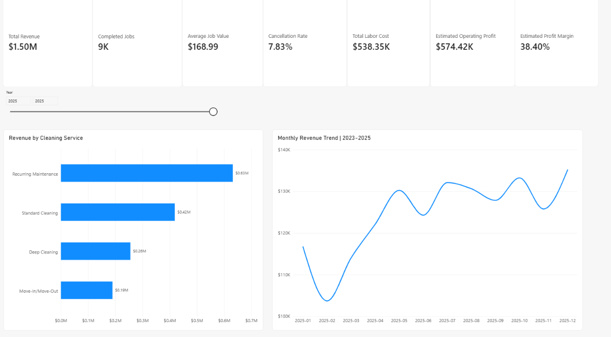
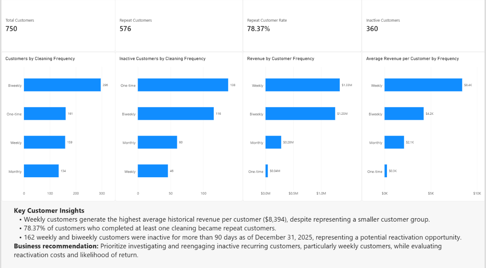
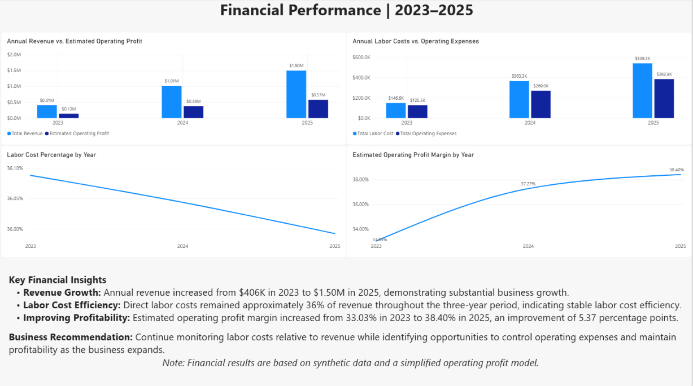
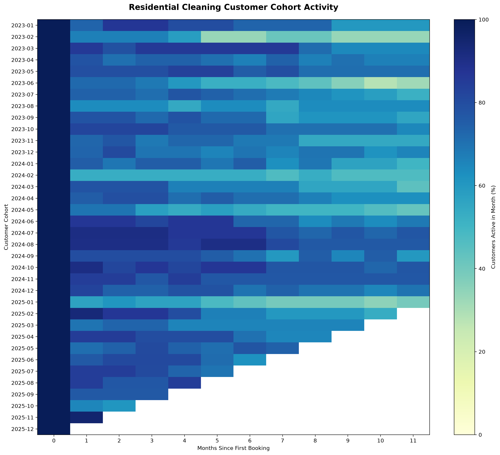

# Residential Cleaning Business Analytics

## Project Overview

An end-to-end data analytics project examining the financial performance, customer retention, and operational efficiency of a residential cleaning business from 2023 to 2025.

Using a synthetic business dataset, I developed a SQLite database, performed SQL-based analysis, and built an interactive Power BI dashboard to identify business trends and opportunities for improvement.

## Business Objectives

- Evaluate revenue growth and profitability.
- Analyze customer retention and cleaning frequency.
- Identify inactive customers for potential reactivation.
- Compare service performance and labor costs.
- Translate analytical findings into actionable business recommendations.

## Tools & Technologies

- **SQL (SQLite):** Business queries, aggregations, joins, and customer analysis.
- **Python:** Data generation, processing, and retention visualization.
- **Power BI:** Interactive dashboards, DAX measures, and financial reporting.
- **VS Code:** Project development and organization.

## Key Business Findings

### Financial Performance

- Total revenue reached **$2.91M** across 17,220 completed jobs.
- Revenue increased from $406K in 2023 to $1.50M in 2025.
- Direct labor costs remained approximately 36% of revenue.
- Estimated operating profit margin improved from 33.03% to 38.40%.

### Customer Analytics

- 750 customers were included in the dataset.
- 78.37% of customers with at least one completed job became repeat customers.
- Weekly customers generated approximately $8,394 in average historical revenue per customer.
- 162 weekly and biweekly customers were inactive for more than 90 days as of December 31, 2025.

### Business Recommendations

1. Investigate opportunities to reactivate inactive recurring customers.
2. Monitor labor costs relative to revenue as the business grows.
3. Evaluate service profitability when making pricing and staffing decisions.
4. Track retention and customer value to support long-term growth.

## Power BI Dashboard

**[Download the Interactive Power BI Dashboard](dashboard/cleaning_business_analytics.pbix)**

Open the downloaded file in Power BI Desktop to explore the three report pages, filters, and DAX measures.


### Executive Overview



### Customer Analytics



### Financial Performance



## Customer Retention Analysis



## Project Structure

## How to Run This Project

### Requirements

- Python 3
- Power BI Desktop
- SQLite (accessed through Python)

### Setup

1. Clone this repository:

   ```bash
   git clone https://github.com/Bianka1990Bianka/cleaning-business-analytics.git
   ```

2. Navigate to the project folder:

   ```bash
   cd cleaning-business-analytics
   ```

3. Install the required Python packages:

   ```bash
   pip install -r requirements.txt
   ```

### Explore the Analysis

- Open `notebooks/01_data_quality.ipynb` to review the data quality analysis.
- Explore the SQL queries in the `sql/` folder.
- Review the provided SQLite database in `data/cleaning_business.db`.
- View the customer retention heatmap in `reports/`.

### Explore the Dashboard

1. Open Power BI Desktop.
2. Open `dashboard/cleaning_business_analytics.pbix`.
3. Explore the three report pages:
   - Executive Overview
   - Customer Analytics
   - Financial Performance

**Note:** The repository includes synthetic datasets and a prebuilt SQLite database, so generating new data is not required to explore the existing analysis.


- `data/` — Synthetic datasets and SQLite database
- `dashboard/` — Power BI dashboard file
- `notebooks/` — Python analysis notebooks
- `sql/` — SQL business analysis queries
- `src/` — Python scripts
- `reports/` — Dashboard screenshots and visualizations

## Data Disclaimer

This project uses synthetic data created for educational and portfolio purposes. The financial results are illustrative, and estimated operating profit is based on a simplified cost model.

## About This Project

This project combines technical data analytics skills with practical knowledge of residential cleaning business operations to demonstrate how data can support business decision-making.
